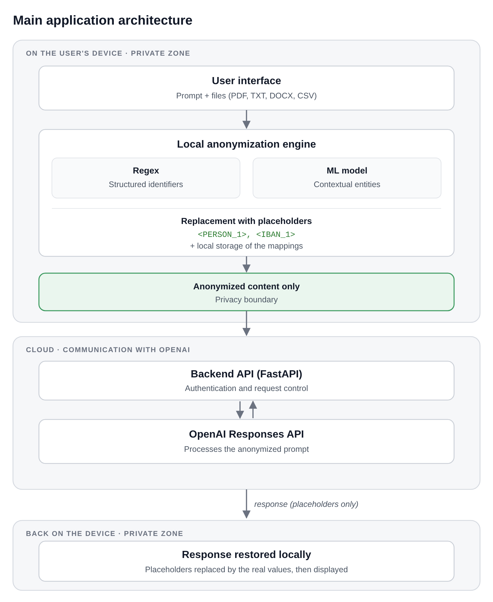
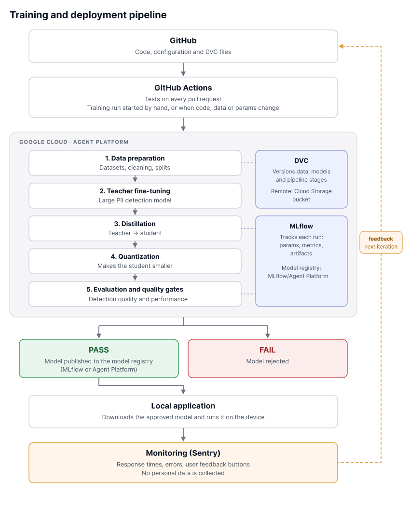

# Architecture

This page describes the two parts of the project: the application that pseudonymizes data on the user's device, and the MLOps pipeline that trains, delivers and monitors its model. Many details are still open. This page gives the structure, not the final choices.

The diagrams are in `docs/diagrams/`. The editable version is in Figma: [Schémas – anonymiseur PII](https://www.figma.com/design/EZFkhnWaznd3MO2BQZWDYB).

## Why our own interface and backend

We first planned to plug the anonymizer into Claude Code with hooks. We now build our own application instead: the user writes the prompt in our interface, we detect the personal data, we replace it, and we send the pseudonymized text to the OpenAI API through our backend.
- **Advantage:** we control the whole path, from the prompt to the response. This is much simpler than working around the limits of the hooks of an existing agent.
- **Drawback:** it only protects requests made through our interface. We assume that users send their LLM requests only through our application.

## 1. Main application architecture

The idea is simple: personal data never leaves the user's device. Only pseudonymized content goes to the cloud.

### On the user's device (private zone)

1. **User interface.** The user writes a prompt and can attach files (PDF, TXT, DOCX, CSV). The user can rate each response from 1 to 5 stars. This feedback goes to monitoring (for now to a local file, without any prompt or response text).
2. **Local pseudonymization engine.** The engine finds personal data in the prompt and in the files. It has two parts that work together:
   - **Regex rules** for structured identifiers, which follow a fixed format.
   - **Our ML model** for contextual entities, such as names or addresses, which need context to be found. This is the model we train ourselves: a student distilled from a larger teacher and quantized, produced by the pipeline in part 2.

   The engine first finds the values (`detect()` in `engine.py`), then replaces them. The replacement (step 3) and the model can therefore change separately, and the evaluation script can measure `detect()` like any other detector.
3. **Replacement.** Each value that the engine finds is replaced by a placeholder, such as `<PERSON_1>` or `<IBAN_1>`. The same value always gets the same placeholder. We chose placeholders over fake values (a fake name such as `Jean Martin` in place of the real one) in issue #17, for three reasons:
   - They work the same way for every type. Fake values would need a generator for each type (names, AVS numbers, IBANs, phone numbers).
   - The restoration is exact. The LLM copies `<PERSON_1>` as it is, while it may shorten or change a fake name.
   - A miss stays visible. A placeholder left in an answer is obvious, while a fake name left in an answer looks real.

   The price is that LLMs tend to write better answers from realistic text, and a placeholder does not tell the LLM whether to write "he" or "she". Goal O2 measures this cost, because its 20 app tasks run with and without pseudonymization ([smart-goals.md](smart-goals.md)). Fake values remain a possible continuation of the project, and step 2 already keeps the replacement apart from detection.

   The engine records each pair in a **mapping table** (placeholder ↔ real value), which is kept on the device only.
4. **Privacy boundary.** Only the pseudonymized content goes past this point.

### In the cloud

5. **Backend API (FastAPI).** It receives the pseudonymized request and handles authentication and request control.
6. **OpenAI Responses API.** It processes the pseudonymized prompt and sends back a response. The response contains the placeholders, never the real values.

### Back on the device

7. **Response restored locally.** The application reads the response, finds each placeholder in it, and looks it up in the mapping table. It then swaps it back to the real value, for example `<PERSON_1>` → `Marie Dupont`, and shows the restored response to the user.

The restoration happens on the device because the mapping table never leaves it. Neither the backend nor OpenAI ever sees the real values.

## 2. Training and deployment pipeline (MLOps)

This pipeline produces the ML model used by the local pseudonymization engine. Training happens in the cloud. The model then runs on the user's device, and its use is monitored.

### Source and automation

1. **GitHub.** It holds the code, the configuration and the small DVC files that point to the data and the models.
2. **GitHub Actions.** It runs the automated tests on every pull request. The training run is expensive (distillation in particular uses a lot of GPU time and credits), so it does not run on every merge: it starts only by hand, or when the code, the data or the parameters of the pipeline change. DVC reruns only the stages whose inputs changed.

### Training on Google Cloud (Agent Platform)

The pipeline runs on Agent Platform, Google Cloud's platform for training and managing models (formerly Vertex AI). It has five steps:

1. **Data preparation.** Collect the training datasets, clean them and format them for training. The pipeline does not create the test sets: T1 and the split of T2 into T2-dev and T2-final are fixed in advance (see [smart-goals.md](smart-goals.md)) and versioned with DVC.
2. **Teacher fine-tuning.** Fine-tune a large PII detection model on our data. This large model is the "teacher".
3. **Distillation.** Train a smaller "student" model to copy the teacher.
4. **Quantization.** Store the student's numbers with fewer bits, so that it is smaller and faster on a laptop.
5. **Evaluation and quality gates.** Measure the student on T2-dev, then compare the results with thresholds fixed in advance. The metrics cover detection quality (how much personal data is found, and how much is masked by mistake) and performance (size and speed). The gates use T2-dev only: T2-final is kept for the final report.

Two tools support every step:

- **DVC** versions the data, the models and the pipeline stages. Its remote storage is a Cloud Storage bucket.
- **MLflow** tracks each run: parameters, metrics and artifacts, so that runs can be compared.

### Release

- **PASS.** If every threshold is met, the model is published to the model registry (MLflow or Agent Platform, to decide).
- **FAIL.** If one threshold is not met, the model is rejected and is not delivered to users.

### Local application

The local application downloads the approved model from the registry and runs it on the device.

### Monitoring

Once the model runs in the application, we monitor how it behaves in real use with Sentry:

- **Response times**, to check that pseudonymization stays fast enough.
- **Errors**, in the application and in the backend.
- **User feedback**, from the star rating in the interface.

## Tools per block

| Block | Tool | Status |
|---|---|---|
| User interface | Streamlit (the engine is in Python, so the page calls it directly) | chosen |
| Regex rules | Python `re` | planned |
| ML model on the device | ONNX Runtime or PyTorch (until our model exists: `qwen3:4b` with Ollama) | to decide |
| Backend API | FastAPI | chosen |
| Backend hosting | Cloud Run | to decide |
| LLM | OpenAI Responses API | chosen |
| Code and CI | GitHub, GitHub Actions | in place |
| Data and model versioning | DVC, remote on Cloud Storage | in progress (#8) |
| Training | Agent Platform (custom training jobs) | chosen |
| Experiment tracking | MLflow | planned |
| Model registry | MLflow or Agent Platform | to decide |
| Monitoring | Sentry | planned |

## Still to decide

- The datasets, and the teacher and student models.
- The metrics and the values of the quality-gate thresholds.
- The tools marked "to decide" in the table above.
- How and when the local application checks for a new model.
- The exact measures that monitoring collects.
